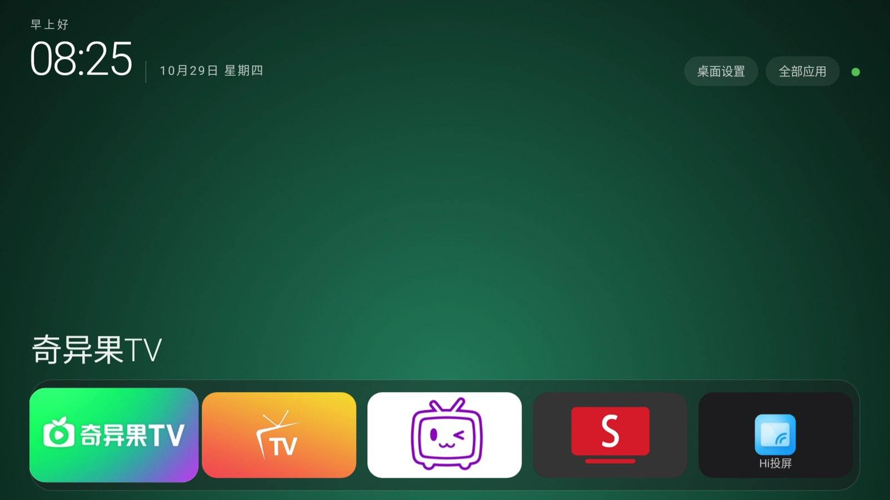

# 海信 VIDAA 电视换桌面实战（70V1F-S / NOVA72691 / Android 9）

把一台海信 70V1F-S（VIDAA 6.5 / Android 9 / Novatek NT72691）的默认桌面从**聚好看**换成自制桌面 **TvHome**
的完整记录：踩过的坑、失败的原因、能用的脚本、以及源码。

不是教程搬运，是一台真机上从 0 到能用的过程记录。**结论先说**：

- 不开 root：**换不了默认桌面**。所有常规路径（`set-home-activity`、优先级、厂商启动指针、无障碍守护）在这台固件上
  全部无效。
- 开了 root：把桌面装进 `/system/priv-app`、HOME filter 给 `priority=100`，**主页键直接进自己的桌面**。
  开机仍会先显示聚好看约 8–10 秒，用一个只在开机跑 90 秒的钩子切过去。



---

## 这台机器是什么

| 项 | 值 |
|---|---|
| 零售型号 | 70V1F-S（BOM 0008） |
| 设备代号 | `VIDAA_TV` / `NOVA72691` |
| 系统 | Android 9 / API 28，`PPR2.180905.006.A1`，软件版本 `04.02.60.03` |
| 芯片 | Novatek n62020（NT72691），只有 32 位 `armeabi-v7a` |
| 内核 | `4.9.118+` #1，2024-02-20 编译 |
| 安全补丁 | 2021-01-05 |
| 原桌面 | `com.jamdeo.tv.vod/com.ju.main.launcher.LauncherActivity`（聚好看），HOME priority 50 |

更多见 [docs/01-设备与固件.md](docs/01-设备与固件.md)。

---

## 三条路线，先看这张表

| 路线 | 主页键 | 开机 | 需要 root | 风险 |
|---|---|---|---|---|
| A. 官方/系统设置里改默认桌面 | ❌ 改不动 | ❌ | 否 | 无 |
| B. 不 root，只用次级入口（图标 / 自定义键） | ❌ 仍回聚好看 | ❌ 仍进聚好看 | 否 | 无 |
| C. **系统应用 + priority 100 + 开机钩子** | ✅ 直达 | ✅ 约 8–10 秒后到 | **是** | 中（写 `/system`） |

如果你的机器不是这台，先看 [docs/02-为什么换桌面这么难.md](docs/02-为什么换桌面这么难.md)：
里面有 7 条失败路径和它们的机制解释，大多数海信 VIDAA 机型会命中其中几条。

---

## 目录

```
docs/
  01-设备与固件.md          这台机器的完整信息
  02-为什么换桌面这么难.md   7 条失败路径 + 机制解释（最重要的文档）
  03-根权限通道.md           root 是怎么来的、怎么用、怎么删
  04-开机接管与守护.md       开机钩子 / 守护进程 / 内存回收
  05-排障与恢复.md           出问题怎么救、看什么日志
  06-逆向资料索引.md         原始报告（内核、固件、服务、kill 路径）
  07-禁用清单与副作用.md     去广告禁错了会坏什么（含 HDMI 信号源的坑）
  notes/                    原始过程记录（未整理，按时间）
launcher/                   自制桌面 TvHome 源码 + 构建脚本 + 成品 APK
scripts/                    开机钩子、看护、恢复脚本
screenshots/                界面截图
```

---

## 快速开始（仅适用于同代海信 VIDAA Android 9，且你接受写 `/system`）

> ⚠️ 写 `/system` 有变砖风险，本机之所以能救回来是因为 `adbd` 在 `/system` 里、而 `/system` 没被写坏。
> 没有对应机型的救砖包时，请先完整备份再动手。

1. **确认机器**：`adb shell getprop ro.build.fingerprint`，和上表一致再继续。
2. **构建桌面**：见 [launcher/README.md](launcher/README.md)（需要 JDK17 + Android SDK build-tools 34 + platform android-28）。
3. **装成系统应用**：见 [docs/03-根权限通道.md](docs/03-根权限通道.md)。
4. **部署开机钩子**：见 [docs/04-开机接管与守护.md](docs/04-开机接管与守护.md)。
5. **验收**：重启后应停在 TvHome；遥控器主页键应直接回到 TvHome。

出问题看 [docs/05-排障与恢复.md](docs/05-排障与恢复.md)，一键恢复：

```powershell
powershell -File scripts\tv-recover-home.ps1
```

---

## 免责声明

- 这些操作在**自己的电视**上完成，仅记录过程，供同好参考。
- 写 `/system`、root、改开机流程都可能让电视变砖或失去保修，风险自负。
- 文中不含任何设备的序列号、IP、账号等信息。
- 如果你的机型不是 70V1F-S / NOVA72691，**不要照抄包名和路径**，先按文档里的命令自查。

---

## 相关

- 上游工具适配（PR）：
  - cleanyourtv（英文设备笔记）：<https://github.com/Gathin23/cleanyourtv/pull/2492>
  - aerial-tv（中文实测记录）：<https://github.com/pengchujin/aerial-tv/pull/872>
- 自制桌面基于 AOSP 原生 View 手写，无第三方依赖。

## License

代码（`launcher/`、`scripts/`）MIT；文档 CC BY 4.0。
