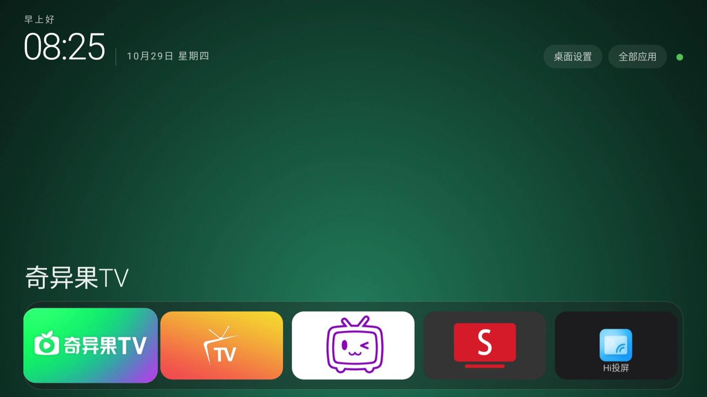

# TvHome · 极简电视桌面

给 1920×1080 安卓电视用的自制桌面，纯 AOSP 原生 View 手写，无第三方依赖。



## 特点

- **极简**：一行 Dock（常用 App）+ 全部应用网格，没有推荐流、没有广告位
- **大卡片**：5 列布局，图标按卡片尺寸自动缩放，遥控器焦点走查顺手
- **时钟**：左上角大号时间 + 日期，30 秒刷新一次
- **全部应用**：单独一页，按名称排序，支持隐藏
- **系统级桌面**：manifest 里带 `HOME` 分类和 `priority="100"`，装成系统应用后可以直接接管主页键

## 目录

```
AndroidManifest.xml     清单（HOME filter + priority 100 + BOOT_COMPLETED 接收器）
src/com/local/tvhome/
  MainActivity.java     主屏：时钟、Dock、卡片网格、长按菜单
  AllAppsActivity.java  全部应用
  AppRepository.java    已安装应用枚举与过滤
  IconLoader.java       图标加载与缓存
  AppEntry.java         应用条目模型
  TileBackground.java   卡片背景绘制
  StockCleaner.java     进入桌面时清理聚好看进程（三级降级策略）
  DebugReceiver.java    调试用：adb 广播触发一次清理（不切界面）
res/                    资源（颜色、图标占位）
adddex.py               把 classes.dex 塞进 aapt2 产出的 APK
build_app.ps1           一键构建（aapt2 → javac → d8 → 签名）
TvHome.apk              已构建好的成品（v1.5，versionCode 9）
```

## 构建

### 前置

| 依赖 | 版本 | 说明 |
|---|---|---|
| JDK | 17 | 只用来跑 `javac` / `keytool` / `apksigner` |
| Android SDK build-tools | 34.0.0 | `aapt2`、`d8`、`zipalign`、`apksigner` |
| Android platform | android-28 | 提供 `android.jar`（bootclasspath） |
| Python | 3.x | 跑 `adddex.py` |

### 跑

```powershell
# 用环境变量指定 SDK / JDK
$env:ANDROID_SDK_ROOT = 'C:\Android\Sdk'
$env:JAVA_HOME        = 'C:\Program Files\Java\jdk-17'
powershell -File build_app.ps1
```

产物在 `build\TvHome.apk`，签名用脚本自动生成的 `build\debug.keystore`（首次运行会建）。

> 想改包名：改 `AndroidManifest.xml` 的 `package`、Java 里的 `R` 引用不用动，但**资源目录路径**和
> `MainActivity` 的相对类名（`.MainActivity`）会自动跟随。改完记得同步 `build_app.ps1` 的 `-ApkName`。

## 安装

### 普通应用（不需要 root，但不能接管主页键）

```console
adb install -r TvHome.apk
```

装上之后能从"全部应用"里打开，但**按主页键仍回聚好看**——原因见
[../docs/02-为什么换桌面这么难.md](../docs/02-为什么换桌面这么难.md)。

### 系统应用（需要 root，能接管主页键）

```console
# 在 root 脚本里
mount -o remount,rw /
mkdir -p /system/priv-app/TvHome
cp /data/local/tmp/TvHome.apk /system/priv-app/TvHome/com.local.tvhome.apk   # 文件名必须等于包名
chown -R 0:0 /system/priv-app/TvHome
chmod 755 /system/priv-app/TvHome
chmod 644 /system/priv-app/TvHome/com.local.tvhome.apk
restorecon -R /system/priv-app/TvHome
sync && mount -o remount,ro /
```

然后 `adb uninstall com.local.tvhome`（如果之前装过普通版）并重启。

详细步骤和两个致命坑见 [../docs/03-根权限通道.md](../docs/03-根权限通道.md)。

## 关键：manifest 里的 HOME 声明

```xml
<intent-filter android:priority="100">
    <action android:name="android.intent.action.MAIN" />
    <category android:name="android.intent.category.HOME" />
    <category android:name="android.intent.category.DEFAULT" />
</intent-filter>
```

`priority="100"` 是为了盖过聚好看的 50。**但只有系统应用才保得住这个优先级**：
普通应用装上去会被固件钳成 0。

## 行为：开机抢跑进 TvHome（v1.8 起）

**v1.4 的自动接管有 60 秒窗口，会把正在用别的应用的用户拽回桌面（真实误触），已废弃。** 现在改成：

- **开机抢跑**：root 钩子（`scripts/rc-minimal.sh`）在 AMS 一就绪就 `am start`，实测比聚好看只晚约 1 秒，早于屏幕亮起；`BootReceiver` 作为「框架软重启」的兜底；
- 每次 TvHome 回到前台时会做一次 `killBackgroundProcesses`（原有逻辑，实测对聚好看基本无效，保留但不再强求）；
- 有 60 秒去抖，避免频繁清理；清理开关在桌面设置里可以关掉。

### 清理为什么要特权权限

实测这台机器上：

| 方式 | 结果 |
|---|---|
| `am kill`（= `killBackgroundProcesses`） | ❌ 进程还在（聚好看有常驻服务托着） |
| `am force-stop` | ✅ 进程消失，`MemAvailable` 758 MB → 860 MB |

`force-stop` 需要 `android.permission.FORCE_STOP_PACKAGES`（`signature|privileged`），
所以必须：

1. TvHome 装在 `/system/priv-app`（已经是）；
2. 在 `/system/etc/permissions/` 里加一条特权权限白名单（`scripts/privapp-tvhome.xml`，
   由开机钩子自动复制）。参考实现：系统自带的 `com.android.tv.settings` 就是这样拿到该权限的。

`StockCleaner` 里按「`killBackgroundProcesses` → 反射 `forceStopPackage` → `exec am force-stop`」
三级降级，哪级成功都能清理；都没权限时只记日志（`adb logcat -s TvHomeKill`），不影响使用。

## 已知限制

- 只测过 1920×1080（`screenOrientation="landscape"`，按 5 列算卡片宽度）
- 没有做多分辨率自适应，换 4K 面板需要调 `COLS` 和 dp 边距
- 图标缓存放在应用私有目录，首次启动会慢一点

## License

MIT


