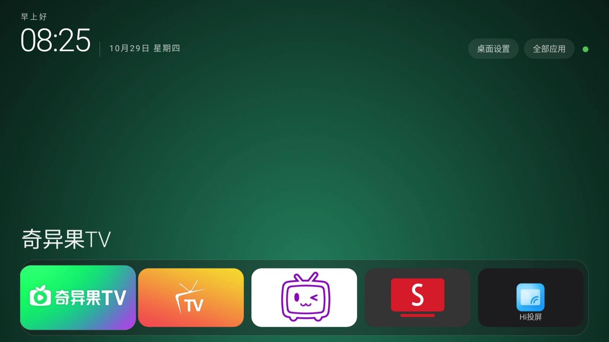

# 界面截图

全部为实机 1920×1080 截屏，压缩为 1600 宽 JPEG。

| 文件 | 说明 |
|---|---|
| `01-home.jpg` | TvHome 主屏：左上时钟、右侧「桌面设置 / 全部应用」、底部 Dock |
| `02-all-apps.jpg` | 全部应用页，5 列网格 |
| `03-live-expanded.jpg` | 直播 / 信号源区域展开态 |
| `04-live-collapsed.jpg` | 直播 / 信号源区域收起态 |
| `05-home-cn.jpg` | 中文版主屏 |
| `06-committed.jpg` | 整理过图标顺序后的主屏 |
| `07-move-grid.jpg` | 移动 / 排序模式下的网格 |
| `08-card-menu.jpg` | 卡片长按菜单 |
| `09-longpress.jpg` | 长按菜单（早期版本） |
| `10-menu.jpg` | 菜单（早期版本） |
| `11-stock-launcher.jpg` | 原厂聚好看桌面，用于对比 |

